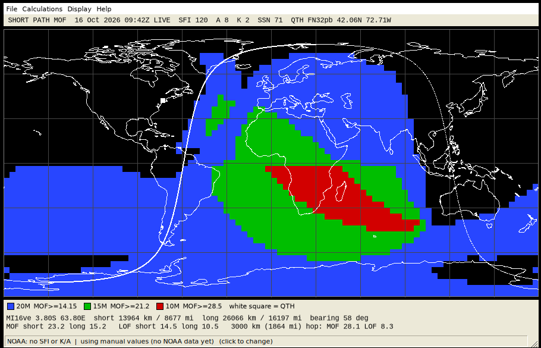
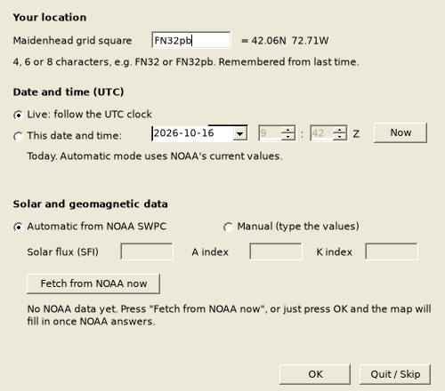

# N1TA MOF/LOF

**A bare-bones HF propagation map for Windows. One `.exe`, no installer, no account, no cloud, no dashboard, no "insights."**

It paints the world in three colours showing where your signal can go (MOF, the *maximum* observed frequency) and where the D-layer is going to eat it (LOF, the *lowest* observed frequency), then pulls today's solar numbers from NOAA so you don't have to.

It is a from-scratch rewrite of the idea behind [K1TTT's MOF/LOF program](https://wiki.k1ttt.net), which has been quietly useful since the DOS era. Credit for the concept and the look belongs to Dave, K1TTT. No K1TTT code was used. Go thank him.



*Short-path MOF from FN32. Blue = 20 m open, green = 15 m, red = 10 m, black = go outside. The white line is the day/night terminator. The white square is you.*

---

## Get it

1. Grab `N1TA_MOFLOF-v1.1.0.zip` from the [Releases](../../releases) page.
2. Unzip. Double-click `N1TA_MOFLOF.exe`.
3. Windows SmartScreen will say it doesn't recognise the app. It is correct: I did not pay for a code-signing certificate to draw coastlines. Click *More info → Run anyway*, or build it yourself (below) and trust your own compiler.

Needs .NET Framework 4.x, which is already on Windows 10 and 11. Windows 7/8 users may need to install it. Nothing is installed; your grid square and preferences live in `%APPDATA%\N1TA-MOFLOF\settings.ini`. Delete the folder and it never happened.

## First five minutes

1. **Start the program.** It asks for your Maidenhead grid square (`FN32`, `FN32pb`, or an 8-character one). Nothing is guessed, nothing is looked up. It remembers your last answer, so next time you just press Enter.
2. **Pick a time.** *Live* follows the UTC clock. Or choose *This date and time* and plan any day you like, including next month's contest. See "Future dates" below.
3. **Pick your solar data.** *Automatic* fetches SFI, A and K from NOAA. *Manual* lets you type your own. Either way the numbers you'll actually get are shown in the boxes.
4. Press OK. Look at the map. **Enter** jumps an hour ahead, **Backspace** back, **A** animates the day. **4** flips from MOF to LOF; **3** and **6** are the composite short/long path views.
5. Hover anywhere on the map. Two lines at the bottom give the grid square under the cursor, the distance in **kilometers and miles** (short path and long path), the bearing, MOF and LOF for both paths, and the 3000 km (1864 mi) single-hop numbers.

Change anything later with **Calculations → Location, date and solar data** (Ctrl+S), or just click the status bar.



No internet? Choose **Manual** and type SFI, A and K. Works fine in a basement, a field day tent, or a bunker.

### Solar data: automatic or manual

| | Automatic | Manual |
|---|---|---|
| Source | NOAA SWPC public feeds | whatever you type |
| Today / live | NOAA's current flux and K; A is the mean of the last 24 h of 3-hourly values | your numbers |
| Future date (up to 27 days) | NOAA's 27-day outlook for that day | your numbers |
| Past date, or more than 27 days ahead | falls back to today's values, and the status bar says so | your numbers (this is what you want for replays and long-range guesses) |
| NOAA unreachable | map still draws, using your last manual values; status bar says why | n/a |

If only part of NOAA's data arrives, the missing numbers come from your manual boxes ("NOAA now + manual fill").

### Future dates

Pick the date in the Start screen. The map is drawn for that exact UTC date and time using that day's season and sun position. For the solar numbers, automatic mode uses NOAA's 27-day outlook when the date is inside it. Beyond 27 days nobody, including NOAA, has a forecast worth the name; type the flux you expect. The Start screen tells you which case you're in as you change the date.

### If NOAA data won't load

Open **Help → NOAA diagnostics**. It lists every request, what came back, and what the program made of it, and it's built for pasting into a [GitHub issue](../../issues). The program never stops working over this: it just uses your manual numbers.

## Keys

| Key | What it does |
|---|---|
| `1` `2` `3` | MOF: short path / long path / composite (best of both) |
| `4` `5` `6` | LOF: short path / long path / composite |
| `7` `8` | MOF / LOF for a 3000 km (1864 mi) single hop centred on each map point (the "online tool" view) |
| `Enter` `Space` `→` | Next hour |
| `Backspace` `←` | Previous hour |
| `A` | Animate (about one hour per second) |
| `L` | Live: follow the UTC clock |
| `R` `X` `G` | Rectangular / north polar / polar centred on your QTH |
| `S` | Sunrise (solid) and sunset (dashed) lines |
| `P` | Great-circle radials from your QTH, every 30° |
| `F5` | Re-fetch NOAA data now |
| `Ctrl+S` | Location, date and solar data |

**Striped cells are the long path.** In the composite views, stripes mean the long way round beats the short way.

## What the colours mean

| MOF map | LOF map |
|---|---|
| blue: MOF ≥ 14.15 MHz (20 m is open) | blue: LOF ≤ 7.1 MHz (40 m is usable) |
| green: MOF ≥ 21.2 MHz (15 m) | green: LOF ≤ 3.6 MHz (80 m) |
| red: MOF ≥ 28.5 MHz (10 m) | red: LOF ≤ 1.85 MHz (160 m) |

Higher bands imply the lower ones. Red on a MOF map means 20 and 15 are open too. A band is only really workable if the MOF is above it *and* the LOF is below it, so flip between the two maps. Thresholds are constants near the top of `MainForm.cs` if you disagree with my band centres.

## Where the numbers come from

* **Solar flux, K and A** come from NOAA's Space Weather Prediction Center public services (`services.swpc.noaa.gov`): the 10.7 cm flux summary, the planetary K-index feed (latest Kp, and the mean of its last eight 3-hourly "a" values as the A index), and the 27-day outlook for future dates. No key, no login. Refreshed every 30 minutes while Live.
* **MOF** is [MINIMUF 3.5](https://apps.dtic.mil/sti/pdfs/ADA066256.pdf), the US Navy's 1978 algorithm, implemented from the published equations. It reproduces the Navy's own sample output (`N1TA_MOFLOF.exe --selftest` checks this). Control points, M-factor, the effective-zenith-angle lag, the winter/high-latitude/transequatorial fudge factors: all in `src/Engine.cs`.
* **LOF** is a standard D-layer absorption model (George-style, as used by ITU-R P.533) with a 52 dB total absorption budget. That budget is my tuning, not a law of nature.
* **A and K** do not appear anywhere in MINIMUF, so I invented something modest: K above 3 trims MOF at mid and high geomagnetic latitudes, and raises auroral absorption (so LOF goes up) as the oval expands equatorward. These are heuristics. They are honest about it in the Notes box. So am I.

## How it differs from K1TTT's original

| | K1TTT | N1TA |
|---|---|---|
| MOF engine | adaptation of MINIMUF-85 | MINIMUF 3.5 (the part I could verify) |
| LOF engine | Piggott / George / Samuel / Bradley, via Radio Netherlands | simple absorption model, tuned by me |
| Solar data | type it in | NOAA fetch, or type it in |
| Contest-log overlay (MMPRINT), replay files | yes | no |
| Runs on | DOS / Win16/32 | anything with .NET Framework 4 |

**Expect the maps to look *similar*, not identical.** If they disagree, the original has a decade of contest logs behind its tuning and I have a verified Navy algorithm and a good attitude. Use both.

## Honest caveats

* Propagation prediction is statistical. This predicts a median ionosphere. Yours will be having its own day.
* MINIMUF is an F-region model. It knows nothing about sporadic E, grey-line enhancement, or that one guy with the 4-element 160 m array.
* Daily flux is noisy. NOAA's "now" value drives the map; a 3-to-30-day average is a steadier planning input, which is what the Start box is for.
* Tested: the engine against the Navy's published sample; the NOAA parsers against samples of the documented feed layouts (including garbage input, which must not throw); the Maidenhead conversion; and the full GUI under Mono on a virtual display (first-run prompt, saved grid, manual entry, all eight map modes, three projections). **Not yet tested:** on a real Windows machine, and against NOAA's live servers (the build environment couldn't reach them). The first public release shipped with a NOAA parser that guessed one file layout wrong; 1.1.0 dropped that file and made every parser tolerant. If NOAA still won't load for you, **Help → NOAA diagnostics** has the evidence.
* The date picker accepts typing on Windows; the Linux test rig could not drive it, so date entry was checked by reading, not by clicking.

## Build it yourself

Needs [Mono](https://www.mono-project.com/) (`mono-mcs`, `mono-devel`). Yes, Mono, on any OS; the output is a normal Windows executable.

```sh
./build.sh                                  # produces dist/N1TA_MOFLOF.exe
N1TA_QUIET=1 mono dist/N1TA_MOFLOF.exe --selftest
```

On Windows you can run `N1TA_MOFLOF.exe --selftest` directly and it pops up the results.

Layout:

```
src/Engine.cs       propagation maths (MINIMUF 3.5, LOF, storm tweaks, sun position)
src/Noaa.cs         SWPC fetch + tolerant parsers + diagnostics log
src/Grid.cs         Maidenhead <-> lat/lon
src/MainForm.cs     the window, the map renderer, settings
src/StartDialog.cs  the one input screen: grid, date/time, solar data
src/SelfTest.cs     --selftest
res/coast.txt       Natural Earth 110m coastline, reduced
build.sh            one-line build
```

Pushing a tag like `v1.1.0` makes GitHub Actions build, self-test, zip and attach the release automatically.

## Support

As the original README said: don't expect much, but feel free to ask. Issues and pull requests welcome. Please keep the UI plain. If your PR contains a gradient, I will find you.

## Credits and licence

MIT licensed (see `LICENSE`). Full credits for K1TTT, the US Navy's MINIMUF authors, Natural Earth and NOAA are in [THIRD_PARTY.md](THIRD_PARTY.md).

73 de N1TA
